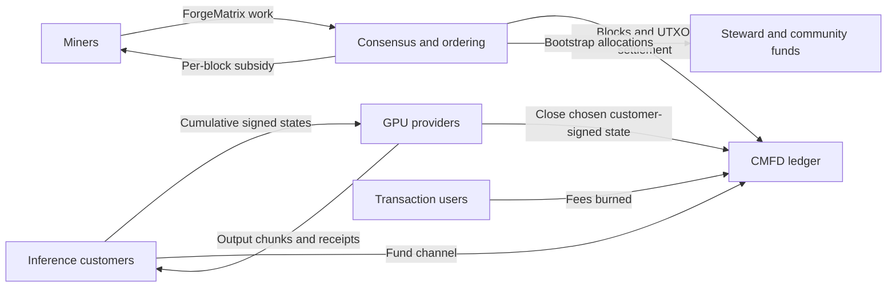
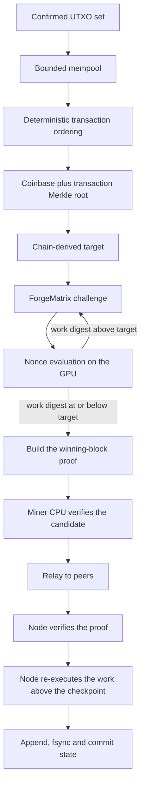
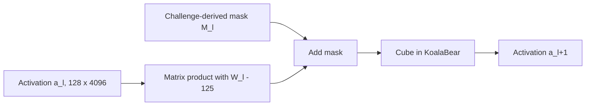
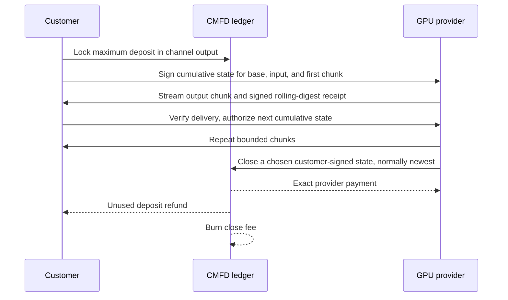

# Common Foundry

## Matrix-Bound Proof of Work and Direct GPU Inference Markets

Technical White Paper, Version 1.0 (mainnet edition), October 2026

Common Foundry

> **Mainnet is live.** Mining opened on 3 October 2026 at 17:00 UTC. The current release is 1.0.16, and its release checkpoint is block 20,912. Source: https://github.com/Common-Foundry-1/CommonFoundry. Explorer: https://explorer.commonfoundry.ai.

---

## Abstract

Common Foundry is a permissionless proof-of-work network built around GPU matrix computation. It separates two activities that claims about "useful proof of work" often mix together. A deterministic, public, matrix-heavy function called ForgeMatrix orders blocks and secures settlement. Separately, an inference market lets customers buy real inference directly from GPU providers through prepaid, progressively authorized payment channels denominated in CMFD. Mining is not customer inference, and an inference receipt is not a proof that a model's answer is correct. The separation is deliberate: consensus must stay deterministic and independently checkable, while commercial inference is varied, latency-sensitive and often private.

ForgeMatrix evaluates 384 sequential 4,096 by 4,096 layers over a batch of 128 rows against a fixed 6 GiB public model bank: 824,633,720,832 multiply-accumulate operations per nonce, computed exactly in the KoalaBear prime field with a block-specific mask and a cubic transition at every layer. Each block carries a 12,025,320-byte transparent proof, built only for the winning nonce and checked by the miner's CPU before the block is sent. Since release 1.0.16, every upgraded node also re-executes the full ForgeMatrix work of each new block above a pinned release checkpoint, from the block's header and nonce, before it accepts the block.

The network launched on 3 October 2026 with no premine. Genesis was derived from a public randomness beacon round that could not be known in advance. The monetary policy is a five-year linear bootstrap from 500 CMFD per block, split 70% to miners, 25% to a steward destination and 5% to a community destination, followed by a permanent 5 CMFD per-block tail paid only to miners. Every transaction fee is burned.

This edition describes the network as it runs today: the consensus rules, the proof of work, how blocks are checked, the node, wallet, miner, pool and exchange software, and the releases since launch. It also covers the inference-market primitives already in consensus and the work that remains.

## 1. Status and scope

### 1.1 Mainnet at a glance

| Item | Value |
|---|---|
| Mining opened | 3 October 2026, 17:00 UTC; block 1 at 17:06:17 UTC |
| Genesis | Derived from drand quicknet round 32,747,812 and the pinned launch plan |
| Premine | None |
| Target block interval | 60 seconds (observed average since launch: about 59 seconds) |
| Proof of work | ForgeMatrix ProductionV4: 128 by 4,096 by 384, KoalaBear field |
| Block checks | Proof verification, plus re-execution of each block's work above the release checkpoint (from 1.0.16) |
| Typical block size | About 12 MB, almost all of it the proof |
| Bootstrap reward | 500 CMFD at block 1, declining linearly to zero over 2,628,000 blocks |
| Split during the bootstrap | 70% miner, 25% steward, 5% community |
| Tail reward | 5 CMFD per block, miner only, from block 2,628,001 |
| Fees | Minimum 0.1 CMFD per transaction; every fee is burned |
| Current release | 1.0.16, release checkpoint 20,912 |
| Addresses | 64-character hex, or checksummed `cmfd1...` (from 1.0.16) |

### 1.2 How to read this paper

Each mechanism is described with its status:

| Label | Meaning |
|---|---|
| **Live** | Enforced or used on mainnet today. |
| **Implemented** | In the released source and covered by tests, but not yet part of a public service. |
| **Planned** | Specified or proposed work that is not released. |

Unless a section says otherwise, everything it describes is live on mainnet.

### 1.3 Parameter rationale

| Parameter | Value | Reason |
|---|---:|---|
| Target block interval | 60 seconds | Responsive settlement, while leaving miners time to build and relay a full proof. |
| Difficulty window | Up to 180 blocks | About three hours of history smooths short bursts and still follows sustained hash-rate changes. |
| Coinbase maturity | 100 blocks | The chain settles before newly mined rewards can be spent. |
| Bootstrap split | 70 / 25 / 5 | Funds mining, continuing engineering and community growth, visibly, in every bootstrap block. |
| Permanent tail | 5 CMFD, miners only | A predictable long-run security budget once the bootstrap allocations end. |
| ForgeMatrix shape | 128 by 4,096 by 384 | A substantial, sequential matrix workload matched to modern GPUs. |
| Model bank | About 6.4 GB | The authenticated model is a meaningful shared resource, not a short seed. |
| Proof / block frames | 13 MiB / 16 MiB | Carries the 12,025,320-byte proof with room for transactions and framing. |
| Minimum fee | 0.1 CMFD, burned | A spam floor that every transaction pays, with no fee income to miners. |

## 2. Why Common Foundry

### 2.1 Three coordination problems

GPU operators face three separate coordination problems:

1. **Permissionless settlement needs an objective ordering rule.** A ledger needs a public predicate that every validator evaluates identically, without relying on a customer, cloud provider, model vendor or oracle.
2. **Inference providers need low-friction incremental payment.** Model execution is streamed, metered and too granular for an on-chain transaction per chunk of tokens, and neither side should have to extend unlimited credit.
3. **A new network needs visible, continuing infrastructure funding.** Engineering, audits, tooling and operator support cost money, but hidden premines and discretionary inflation undermine trust.

Common Foundry gives each problem its own mechanism. Consensus uses one public, deterministic matrix relation that every node can check. The inference market stays free to support private inputs, varied models, changing runtimes and demand-driven scheduling. Infrastructure funding is written into the visible block-reward schedule.



### 2.2 The central thesis

Common Foundry aligns permissionless monetary security, GPU matrix computation, direct inference payments and transparent public-goods funding through rules that every node can reproduce. The alignment is economic:

- ForgeMatrix makes large exact matrix multiplication the dominant cost of mining.
- That work rewards the hardware and operating skills that machine learning also uses.
- The same operators can separately sell inference.
- The chain provides neutral settlement and bounded-exposure payment channels.
- Steward and community allocations are explicit in every bootstrap coinbase.

Mining and customer inference are complementary but separate. Consensus advances whatever the inference demand, and the market can change its models, privacy terms and runtimes without touching block validity.

### 2.3 Why matrix-bound work

ForgeMatrix has a deliberately different cost shape from hash-based proof of work: a large public data set, repeated dense matrix reuse, exact arithmetic and sequential nonlinear transitions. The result is a mining ecosystem aligned with commodity machine-learning acceleration rather than a narrow hash pipeline, with exact cross-platform semantics, bounded parsers, an authenticated model artifact and named hardware measurements.

## 3. System architecture

Common Foundry has five layers:

1. **Consensus library.** Canonical transactions and blocks, UTXO state transitions, reward allocation, fee burning, difficulty, proof selection, the work rule and wire encoding.
2. **ForgeMatrix proof of work.** The public, block-bound computation, its winning-block proof and the engines that re-execute it.
3. **Inference payment protocol.** Signed cumulative customer authorizations, provider receipts and on-chain settlement or refund.
4. **Node runtime.** Peer-to-peer synchronization, fork choice, storage, mempool, mining templates, a loopback RPC, a separate exchange RPC and the pool service.
5. **Applications.** The desktop wallet (with an embedded full node), the standalone GPU miner, the pool and its dashboard, the exchange wallet and the launch and update helpers.

Consensus imports the marketplace types and rules that govern channel spends, so any marketplace function reached from consensus is consensus-critical and is versioned, reviewed and tested with the same discipline as the ledger rules.

### 3.1 Block path



## 4. Ledger and consensus core

### 4.1 UTXO state

Common Foundry uses an unspent-transaction-output model. Each input names a previous transaction identifier and output index. Ordinary outputs are locked to a 32-byte x-only secp256k1 public key and spent with a 64-byte BIP340 Schnorr signature. Inference-channel outputs use a separate structured lock enforced by consensus.

Every transaction commits to the full 32-byte network identifier, and signatures and identifiers use domain-separated hashing, so an object valid on one network cannot be replayed on another.

Validation enforces:

- the expected transaction and block versions;
- exact network identity;
- canonical, bounded encoding;
- unique inputs that spend available UTXOs;
- valid signatures and lock semantics;
- coinbase maturity;
- nonzero outputs and no value creation;
- the minimum fee of 0.1 CMFD on every non-coinbase transaction;
- caps on transactions, inputs, outputs, bytes and signature checks;
- exact accounting for channel settlements and timeout refunds.

### 4.2 Coinbase and maturity

Every bootstrap block creates exactly three coinbase outputs: the miner reward, the steward award and the community award. The miner output matures after 100 blocks. Steward and community outputs are spendable from their creation height; because a block's transactions are validated before its own coinbase is added, they can first be spent in a later block.

The two destinations and the reward rules are fixed network parameters, bound into the consensus fingerprint with the rest of the network's identity. A node cannot accept a different steward or community key, monetary schedule, proof profile or resource limit while claiming to be on the same network.

### 4.3 Wire format and limits

Transactions, proofs and blocks use a fixed 16-byte frame header:

```text
offset  size  field
0       4     ASCII "CMFD"
4       4     network-derived magic
8       2     little-endian wire version
10      1     object kind
11      1     flags, currently zero
12      4     little-endian payload length
```

The decoder rejects unknown tags or kinds, nonzero flags, excessive counts or lengths, truncation, malformed fixed-width fields, noncanonical nested encodings and trailing bytes. Mainnet limits are:

| Resource | Bound |
|---|---:|
| Block frame | 16 MiB |
| Proof frame | 13 MiB |
| Transaction frame | 64 KiB |
| Transactions per block | 1,024 |
| Inputs / outputs per transaction | 128 / 128 |
| Aggregate inputs / outputs per block | 4,096 / 4,096 |
| Signature checks per block | 2,048 |
| Coinbase outputs | 3 |

These are parser-safety and consensus choices, not throughput claims. Fixed-width little-endian fields and explicit count caps let consensus reject ambiguous representations and allocate memory only after checking declared sizes. Since 1.0.3, peers can exchange block frames compressed with DEFLATE, which makes them about 30% smaller on the wire and on disk; the consensus encoding is unchanged.

### 4.4 Difficulty adjustment

The target interval is 60 seconds, and the target is recalculated for every block from at most the most recent 180 header-work records. Let `Nw` be the number of records in the window, `T_i` their targets and `t_i` their effective timestamps. For `Nw > 1`:

```text
average_target = floor(sum(T_i) / Nw)
expected_span  = (Nw - 1) * 60
actual_span    = clamp(t_last - t_first,
                       expected_span / 3,
                       3 * expected_span)
next_target    = min(pow_limit,
                     max(1,
                         floor(average_target * actual_span /
                               expected_span)))
```

A block must carry exactly this independently derived target. Arithmetic uses checked 256- and 512-bit integers. On mainnet the easiest allowed target (`pow_limit`) accepts a digest with probability 1/1,024 per attempt, and mining opened at five times that minimum difficulty.

A raw timestamp must exceed the median of the previous 11 timestamps and may be at most 24 hours ahead of the validating node's clock. The retarget history uses effective median timestamps rather than raw miner timestamps, which limits timestamp manipulation.

### 4.5 Chain work and fork choice

The work assigned to a target `T` is:

```text
work(T) = floor(2^256 / (T + 1))
```

Cumulative work is kept in 512 bits. A side branch replaces the active one only when its fully validated cumulative work is strictly greater; equal-work branches keep the existing tip. There is no finality rule beyond the release checkpoint described in section 7.4, and the network otherwise inherits Nakamoto-style majority-work assumptions and reorganization risk.

### 4.6 Addresses

An address is the 32-byte x-only public key. It has two text forms:

- **Hex:** 64 lowercase hexadecimal characters, with no checksum. This was the only form before 1.0.16 and is still accepted everywhere.
- **Checksummed (from 1.0.16):** bech32m (BIP-350) with the prefix `cmfd` on mainnet, 63 characters in all. The checksum detects any error that changes up to four characters.

Every 1.0.16 input path (node, wallet, exchange RPC, miner and pool launchers) accepts either form. Output stays hex for compatibility; the wallet's receive screen and the explorer show the `cmfd1...` form beside it.

## 5. Monetary policy and funding

### 5.1 Units and the five-year bootstrap

One CMFD is 100,000,000 atoms. With a 60-second target, five 365-day years contain:

```text
N = 5 * 365 * 24 * 60 = 2,628,000 blocks
```

The subsidy starts at 500 CMFD and declines linearly. For block height `h` with `1 <= h <= N`:

```text
R(h) = floor(50,000,000,000 * (N - h + 1) / N) atoms
```

From height `N + 1` onward, the subsidy is a permanent 5 CMFD paid only to the miner.

| Height | Total subsidy | Miner | Steward | Community |
|---:|---:|---:|---:|---:|
| 1 | 500.00000000 | 350.00000000 | 125.00000000 | 25.00000000 |
| 525,600 | 400.00019025 | 280.00013318 | 100.00004756 | 20.00000951 |
| 1,314,000 | 250.00019025 | 175.00013318 | 62.50004756 | 12.50000951 |
| 2,628,000 | 0.00019025 | 0.00013318 | 0.00004756 | 0.00000951 |
| 2,628,001 | 5.00000000 | 5.00000000 | 0 | 0 |

<!-- PDF_FIGURE:emission -->

### 5.2 Per-block allocation

During the bootstrap:

```text
steward   = floor(R(h) * 25 / 100)
community = floor(R(h) *  5 / 100)
miner     = R(h) - steward - community
```

The rounding remainder goes to the miner, so the three outputs always sum exactly to the scheduled subsidy. Once the tail begins, the whole 5 CMFD goes to the miner and both public-goods streams stop.

Total bootstrap issuance is:

```text
E_bootstrap = sum from k=1 to N of floor(R0 * k / N)
            = (R0*N + R0 - N + gcd(R0,N)) / 2
            = 65,700,024,998,688,000 atoms
            = 657,000,249.98688000 CMFD
```

| Recipient | Bootstrap CMFD |
|---|---:|
| Miners | 459,900,175.01312000 |
| Steward | 164,250,062.48688000 |
| Community | 32,850,012.48688000 |
| Total | 657,000,249.98688000 |

After the bootstrap, the tail adds 2,628,000 CMFD per 365-day year at target spacing, about 0.4% of bootstrap issuance in the first tail year and less each year after. There is no maximum supply. The tracked supply is gross issuance minus burned fees.

### 5.3 Supply so far

The explorer publishes supply figures at `/api/supply`. At height 23,199 (19 October 2026), total supply was 11,541,099.88538639 CMFD, after 7,204.3 CMFD of fees had been burned. Excluding the steward and community balances, circulating supply was 8,404,969.12069440 CMFD. The figures reconcile exactly with the schedule: the subsidy minted for heights 1 to 23,199 equals total supply plus burned fees.

### 5.4 Why the bootstrap declines linearly

A linear per-block decline avoids halving cliffs: the schedule is transparent at every height, and miner revenue never drops by half overnight. The reward depends on height rather than timestamp, so miners cannot speed up issuance by choosing timestamps, and every node derives the same subsidy without relying on wall-clock estimates.

### 5.5 Why the tail is permanent and miner-only

Every fee is burned, so the permanent 5 CMFD tail gives miners a simple, predictable long-run security budget. Paying it only to miners keeps the post-bootstrap rule clear: the steward and community allocations end with the bootstrap, and proof-of-work security continues.

### 5.6 Why fees are burned

For an ordinary transaction:

```text
fee_burned = sum(input values) - sum(output values)
```

No output pays that difference to a miner, and inference-channel closes burn their close fee the same way. The coinbase is checked only against scheduled emission. Burning keeps scheduled issuance the only source of coinbase value, keeps block-ordering incentives independent of fee volume and lets network usage offset part of the permanent tail.

### 5.7 Why the steward and community awards are per block

Per-block awards replace an up-front premine and make the distribution visible in every block. They decline with issuance and end when the tail begins. Because they are spendable immediately, engineering and ecosystem work can be funded continuously. The steward and community destinations are fixed public keys, so anyone can follow their balances; the explorer's supply endpoint reports both.

## 6. ForgeMatrix proof of work

### 6.1 Design goals

ForgeMatrix makes exact dense matrix multiplication the dominant cost of evaluating a nonce. A valid block shows that the exact committed function was evaluated for the exact block challenge and that the resulting work digest is at or below the chain-derived target.

The function uses only facts that every node can reproduce: a public model bank, a public block challenge, exact field arithmetic and a deterministic work digest. Hardware choice stays open. Any implementation that computes the identical relation is valid, which keeps consensus vendor-neutral while letting efficient GPU implementations compete on performance.

Mainnet runs the ProductionV4 profile (algorithm version 4). It keeps the full ForgeMatrix workload of the earlier research profiles and computes it in the KoalaBear prime field, which GPUs handle natively.

### 6.2 Parameters

| Parameter | Value |
|---|---:|
| Batch rows `B` | 128 |
| Matrix dimension `D` | 4,096 |
| Sequential layers `L` | 384, in 3 banks of 128 |
| Model byte alphabet | 0 through 250, used as `x - 125` |
| Field | KoalaBear, `p = 2^31 - 2^24 + 1 = 2,130,706,433` |
| Mask coefficients per layer | 20 (one constant, 7 row bits, 12 column bits) |
| Final activation | 524,288 field elements (128 x 4,096), 2 MiB |

The weight bank contains:

```text
L * D * D
= 384 * 4096 * 4096
= 6,442,450,944 bytes
= exactly 6 GiB
```

One nonce performs:

```text
L * B * D * D
= 384 * 128 * 4096 * 4096
= 824,633,720,832 multiply-accumulate operations
```

### 6.3 Model bank

The model bank is one fixed public artifact: a 184-byte header, a 524,288-byte base table and the 384 weight matrices, 6,442,975,416 bytes in total (about 6.4 GB packaged). Every payload byte lies in `0..250`. The bank is seedless: its bytes are the data itself, not something regenerated from a short seed, so it is a real shared resource that miners and verifiers both hold.

Each release pins the bank's identity (its manifest digest, a BLAKE3 root over the raw bytes and the committed form the proof system uses). Nodes, wallets and miners authenticate the whole bank against the pinned identity before they use it.

### 6.4 Block challenge

Each nonce has a challenge digest, computed with BLAKE3 in derive-key mode under the context `CommonFoundry/ForgeMatrix/V4/Challenge/v1` over:

```text
u32le(1)
|| network_id[32]
|| previous_block[32]
|| transaction_root[32]
|| u64le(height)
|| u64le(timestamp)
|| target[32]
|| u32le(algorithm_version)
|| u32le(proof_version)
|| proof_system_digest[32]
|| model_manifest_digest[32]
|| u64le(nonce)
```

The transaction root includes the coinbase, so a miner cannot change the reward outputs or the transactions after finding work.

From the challenge, a deterministic expansion derives a mask for the initial activation and for each of the 384 layers: 20 coefficients (a constant, seven coefficients over the row-index bits and twelve over the column-index bits), giving an affine mask `M_l(r, c)` that is specific to the block, the nonce and the coordinate. No work carries over between blocks or nonces.

### 6.5 Layer computation

All arithmetic is canonical KoalaBear field arithmetic. A model byte `x` contributes the value `x - 125`. The initial activation comes from the base table, and each layer is a masked matrix product followed by a cube:

```text
a_0[r][c]     = (base[r][c] - 125 + M_init(r, c))^3

a_(l+1)[r][c] = ( sum(k = 0..4095, a_l[r][k] * (W_l[k][c] - 125))
                  + M_l(r, c) )^3          for l = 0 .. 383
```

The cube is a permutation of the field (because `gcd(3, p - 1) = 1`), so the step is non-linear without losing information, and every layer depends on the full output of the one before it. The 384 layers must run in sequence.



The relation is exact. Floating point, TF32, rounding, saturation and implementation-defined overflow are not consensus operations, and any implementation that reaches the same field elements is valid. The node's CPU engine, for example, runs the products as float64 matrix multiplications over the raw model bytes and applies the `- 125` correction in exact integer arithmetic afterwards. Every partial sum stays below `4096 * 250 * p < 2^53`, so the result is exact and does not depend on summation order, blocking or thread count.

### 6.6 Work output

After the last layer, the 524,288 final activation values are hashed with the challenge:

```text
final_activation_digest = BLAKE3-DK("CommonFoundry/ForgeMatrix/V4/FinalActivation/v1",
    challenge_digest || u64le(524288) || u32le(a_384[0]) || ... )

work_digest = BLAKE3-DK("CommonFoundry/ForgeMatrix/V4/Work/v1",
    u32le(1) || u32le(algorithm_version) || u32le(proof_version)
    || proof_system_digest || model_manifest_digest
    || challenge_digest || final_activation_digest)
```

The work digest is read as an unsigned big-endian 256-bit integer, and a valid block satisfies `work_digest <= target`. It contains no proof bytes, so a winning computation cannot be ground further over prover randomness, and any node can recompute it from the block header, the nonce and the model bank alone. Since 1.0.16, nodes do exactly that for every new block (section 7).

The normative byte layouts are in `docs/consensus/production-v4-core-spec-v1.md`, with a machine-readable canonical vector for independent implementations.

## 7. How blocks are checked on mainnet

A node on release 1.0.16 or later checks every new block in two independent ways. It verifies the block's proof, and it re-executes the block's ForgeMatrix work itself, from the header and nonce, before it accepts the block. Section 7.1 covers the proof; sections 7.2 to 7.6 cover the work rule that 1.0.16 added.

### 7.1 The winning-block proof

The mining loop evaluates candidate nonces on the GPU. Only when a nonce's work digest meets the target does the miner build the full proof for it. Search stays optimized for fast repeated evaluation, and the cost of proving is paid once per winning block.

The proof is transparent: its parameters and artifacts can be reproduced from public inputs, with no trusted setup. It uses the algebraic structure of the batched matrix products instead of one generic constraint per multiply-accumulate, and it works natively in the KoalaBear field, which keeps proving within a mining interval on a single GPU. Every mainnet proof is exactly 12,025,320 bytes, which is why a typical block is about 12 MB.

Before submitting, the miner checks the complete candidate on its CPU with the same verifier that receiving nodes use. Receiving nodes authenticate their own pinned verifier artifacts, parse the block under the 13 MiB proof and 16 MiB block limits and verify the proof independently.

Measured proof times depend on the card and the release. During release-candidate testing, an RTX 5090 built the online proof in 6.1 seconds after 0.47 seconds of replay, and a physical RTX 5070 Ti 16 GB completed the whole three-process path in 74.3 seconds. Mainnet pool workers on an RTX 4090 build a proof in roughly 9 to 14 seconds, depending on configuration.

### 7.2 The work rule

From 1.0.16, nodes re-execute the work of every new block above the release checkpoint before they accept it:

- At or below the checkpoint height, a block must be exactly the block that the release pins for that height.
- Above the checkpoint, a block must descend from the checkpoint block, and the node recomputes the block's ForgeMatrix work (the forward pass of section 6) from its header and nonce. The block is accepted only if the recomputed work digest equals the one the block claims.

The rule applies from height 20,913, the first block above the 1.0.16 checkpoint. It does not change the network's identity: the checkpoint is not part of the consensus fingerprint, so nodes on different releases still recognize each other as the same network. Miners need no new software, because an honestly mined block already satisfies the rule. Operators of nodes, pools and exchanges should run 1.0.16 or later; older nodes do not perform these checks.

A block that extends the node's tip, or lies within six blocks of it, is checked as it arrives, on its own lane after the proof check. Other stored blocks are checked in the background, lowest first. A node reports how far it has checked as `validated_height` in its `/v1/status` `work_rule` object.

### 7.3 Two engines

A node can re-execute work with two structurally different engines:

- **CPU engine.** The consensus executor runs the forward pass over the authenticated model bank, with float64 matrix multiplications and an exact integer correction (section 6.5). It either holds the bank in memory (`--work-bank resident`, about 6 GiB plus headroom) or streams it from disk layer by layer, checking each layer against its pinned root. It runs at below-normal priority, by default on half the logical processors, at most eight.
- **GPU engine.** A pool node borrows an idle replay worker, the same GPU program the pool uses to check shares. It does this only while that worker runs the exact replay worker shipped with the release, which the node fingerprints at startup and every time a worker starts.

Every engine must reproduce known answers before it is trusted, and does so again periodically while it runs; an engine that fails is taken out of service.

The two engines guard against each other's faults:

- A match from any engine is final, and the block is accepted.
- Any mismatch refuses the block for now.
- A mismatch found by one engine alone is not final. It costs the sending peer nothing and is not recorded as invalid. When the other engine is available, the block is checked again on it. If the other engine matches the block, the block is accepted, an alarm is raised and the disagreeing engine is retested.
- Only a mismatch that both engines reproduce is confirmed. Only a confirmed mismatch is stored, carried to the block's descendants or allowed to cost the sender a penalty.
- An engine failure is never a verdict on the block. The check is reported as unavailable and retried.

A peer whose blocks produce single-engine refusals may have at most two of them in any 10 minutes (an IPv6 /64 counts as one address). After that, its other blocks that need a check are answered as busy until the oldest refusal ages out. The same block from any other peer is checked as usual.

On the CPU, a block check takes seconds to tens of seconds, depending on the processor and on whether the bank is held in memory. On a pool's GPU it is far faster.

### 7.4 Release checkpoints

The 1.0.16 checkpoint is block 20,912, with block id `ed71b4dad46f43a313a4822bf0dc62fef4f29997d39c12cf96b7107eea95a967`. The release carries the canonical list of all 20,912 block ids up to it (669,184 bytes, BLAKE3 `c8fde34e92478a8523c1f13b7d306582e841db318484426254fe3a5416166c26`). A production mainnet build refuses to compile without a pinned checkpoint.

Later releases can move the checkpoint forward. A node then re-executes only the blocks above the new checkpoint, so the cost of a first start after an upgrade stays bounded however long the chain grows.

### 7.5 Wallets: catch-up and "Verifying"

The desktop wallet runs a full node and applies the same rule. Coins in blocks it has not checked yet appear as **Verifying**: they count in the total balance, but cannot be sent or consolidated until those blocks are checked. The wallet's own change is never held back, and solo mining waits until the newest blocks are checked.

After time offline, the default `--work-check standard` mode catches up faster. The wallet may take a block before re-executing it only when two Common Foundry relays run by different providers both list it, the block lies at least 60 blocks below the height both report, it extends the wallet's own tip and its work meets a reference bound. The newest blocks are always re-executed on the wallet's own computer, and every block taken this way is still re-executed in the background. Coins become spendable once at least 60 blocks this computer re-executed sit on top of them. If fewer than two relays can be reached, or once the release checkpoint is more than 60 days old, the wallet checks every block itself. `--work-check full` checks every block before any coin in it shows as available.

Background checking of older blocks pauses on battery power; the newest blocks are still checked.

### 7.6 Pools and exchanges

A pool node checks the blocks it has stored since the checkpoint before it hands out work, then checks each new block before it moves its mining template to it. With the release's replay worker the first start takes minutes and each new block is checked quickly; on the CPU alone, the first start takes hours and every new block waits for a CPU check.

For exchanges, chain reads, block counts and confirmations on the exchange RPC stop at the validated height. A transaction in a block above it reads as `pending_check` with zero confirmations, and the retryable error `-32030` signals a check in progress. An exchange therefore never credits a deposit in a block its node has not re-executed.

### 7.7 How the proof system was chosen

ProductionV4 is the last of a series of working prototypes. Early sumcheck and GKR prototypes expressed the full matrix relation as exact field identities. Later experiments fixed canonical proof encodings, artifact identity checks and bounded parsing. A BLS12-381 commitment profile (ProductionV3) proved and CPU-verified the full 128 by 4,096 by 384 workload and supplied a complete correctness reference. ProductionV4 kept that workload and moved the proof into a GPU-native field, which brought winning-block proving down to seconds on a single consumer GPU.

## 8. GPU hardware

### 8.1 Memory and the model bank

The raw weight bank is 6 GiB, and a GPU implementation also needs activations, runtime state and headroom. On mainnet, the search and replay path needs about 6.45 GiB of device memory, so 6 GB cards cannot hold it; 8 GB is the practical minimum for mining. Building the winning-block proof needs about 7 GiB more of free device memory. A pool usually builds proofs on a separate GPU from the ones that check shares.

### 8.2 Supported hardware

The official NVIDIA miner targets Volta and RTX 20, 30, 40 and 50 series cards. Proving on Ampere (RTX 30 and A-series) cards was added in 1.0.14. An open-source, no-fee AMD ROCm/HIP pool miner ships with 1.0.16 for Linux; its Windows support through WSL2 is experimental and has not yet been tested on real AMD hardware.

Hash rate is quoted in FW/s: complete ForgeMatrix nonce evaluations per second, not raw GPU operations.

### 8.3 Open competition

Consensus is implementation-neutral: any CPU, GPU, FPGA or ASIC that computes the exact relation is valid. Implementers can explore tiling, streaming or other memory strategies, because nodes check results, not a particular memory layout. Third-party miners already exist, and the 1.0.14 pool replay worker adopted the fused kernel of one of them, FreeForgeMiner, under its MIT license.

The project's measurement goal is that a fully resident implementation keeps a clear advantage over the best valid implementation that streams the bank or uses a small card. Benchmarks for that claim must compare identical nonces and outputs across physical cards, with fixed drivers and software versions, repeated trials and power measurements; artificially capping memory on one large card is not a substitute.

## 9. Mining on mainnet

### 9.1 Solo mining

The desktop wallet can mine solo with its embedded node. Solo mining needs, in addition to the 6.4 GB bank, about 61 GB of model inputs that the prover uses. It waits until the wallet has checked the newest blocks (section 7.5). Mined rewards mature after 100 blocks, so a miner can have accepted blocks while its spendable balance is still zero.

### 9.2 Pool mining

Most miners use a pool. The standalone `cmfd-miner` is a thin pool client for Windows (through WSL2), Linux and HiveOS, with one process per GPU. It holds no chain database: the pool node keeps the mempool, synchronization, validation and fork choice.

The packaged pool runs `cmfd-node pool-serve` as a Linux systemd service with a bundled dashboard, and anyone can operate one. Its protocol is specific to Common Foundry, not Bitcoin Stratum:

- **Transport.** Miners connect to `cmfd+tls://<numeric-ip>:29445?pin=<certificate-sha256>`: TLS 1.3 pinned to the exact certificate, numeric endpoints only. A fresh Schnorr challenge then proves control of the payout key.
- **Jobs.** A job carries the complete block challenge and a separate share target that is easier than or equal to the chain target. A miner submits only the job identifier and a nonce, never a proof or a digest.
- **Share checking.** The pool re-executes every submitted nonce on its own GPU before crediting it. A share that also meets the chain target becomes a block candidate: the pool builds the proof and submits the block through normal node admission.
- **Rewards.** PPLNS weighted by exact share work, with a window of one expected block of shares by default. Credit is released after the 100-block maturity, the operator fee is configurable (3% by default) and payouts burn at least the 0.1 CMFD minimum fee.
- **Operations.** Batched share checks, one replay worker per GPU, an archived ledger, proof pruning, connection limits and an optional sponsor-funded bonus reserve.

Under the 1.0.16 work rule, a pool checks new blocks before moving its template, preferably on its GPU replay worker (section 7.6).

## 10. Network and node runtime

### 10.1 Peers

Nodes speak a Common Foundry peer protocol on TCP port 29444. A new node starts from compiled bootstrap peers: one seed and three relays, in St. Louis, Singapore and Falkenstein. It then adds peers it discovers. These addresses are operational defaults, not part of the network's identity, and `--peer` replaces them.

Peers exchange the network identifier, the consensus fingerprint, the tip, the height and the cumulative work. The fingerprint detects nodes with different consensus parameters; it does not authenticate peers or encrypt traffic. Remote height and work are hints: local validation and locally computed cumulative work decide what is accepted.

### 10.2 Synchronization

A sync session moves up to 16 blocks, fetched from several peers at once, with the fastest peer favored during catch-up and parallel proof checks. Compressed block frames (1.0.3 and later) cut transfer sizes by about 30%. For a fast first start, the project also publishes a signed chain bootstrap: a block-log snapshot plus startup state that the bundled scripts check against the release key before use. Nodes still verify everything they load. A full history archive of record-aligned block-log segments is also available for download.

### 10.3 Storage

Each data directory holds an exclusive lock, the network metadata and an append-only `blocks.log` of canonical, checksummed block records. A block is fully validated before anything changes, appended and synchronized to disk, then committed in memory. Replay checks record checksums, canonical encoding, the network fingerprint, consensus validity and cumulative work. A startup index (from 1.0.13) lets a node restart quickly and re-check its history in the background.

Blocks are about 12 MB, almost all of it the proof. Without pruning, that is about 12 GB of new data per day after compression. Pruning (from 1.0.11) drops proofs older than a chosen window but keeps every header, coinbase and transaction. The desktop wallet keeps the newest 720 blocks (about 12 hours) in full by default, so its full blocks level off at roughly 6 to 9 GB. Servers and archive nodes can keep everything.

### 10.4 Mempool and templates

The mempool holds confirmed-input transactions under fixed count and byte caps, with first-spend-wins conflict handling. Template order follows transaction identifiers, so nodes holding the same transactions build the same template whatever order they arrived in. Channel closes have their own mempool budget (128 closes and 96 KiB), and a close beyond it is refused with a retryable error. Reorganizations revalidate the pool against the new active state.

### 10.5 Interfaces

- **Node RPC** on loopback port 29443. Routes that touch the wallet, mining or submissions answer only requests whose `Host` is a loopback name, so a web page that re-resolves its own hostname to the loopback address (DNS rebinding) cannot reach them.
- **Exchange RPC**, a separate authenticated listener that is off by default (section 11.4).
- **Explorer** at https://explorer.commonfoundry.ai, with block pages, a rich list and supply endpoints (`/api/supply` and `/api/supply/total`).

## 11. Wallets, releases and exchanges

### 11.1 Desktop wallet

The desktop wallet for Windows and Linux embeds a full node, so it validates the chain itself, including the 1.0.16 work rule. It needs no GPU for receiving, sending or validating. Keys are stored encrypted, with a separate encrypted backup, and signing happens in the node process; the user interface never receives a private key.

Normal sends choose mature, unreserved outputs largest-first. Miners can consolidate many small reward outputs into one, which burns a fee and should be done only when fragmentation warrants it.

### 11.2 Releases and updates

Every release is published with `SHA256SUMS.txt` and an OpenSSH Ed25519 signature from the release key (identity `commonfoundry-mainnet-owner`, fingerprint `SHA256:cA1Tsf8hL/pxDV5WpOE3iPW3b4uDQosu1dOh//4a/fk`), the same key since 1.0.0. Release archives are built twice and checked to be byte-identical before signing.

From 1.0.16, the desktop wallet can update itself. It checks the release list shortly after opening and then about every six hours. It installs an update only if the checksum file is signed by its built-in release key, the archive matches it and the signed version is newer and for the same network. The new version installs beside the old one, the previous version is kept and wallet data is never moved. Automatic updates are on by default, and `--no-auto-update` turns them off. 1.0.16 itself is installed by hand.

### 11.3 Mining and wallet keys

Each wallet generates its own Schnorr key. Pool miners prove control of their payout key by signing a fresh challenge from the pool; the private key never leaves the wallet.

### 11.4 Exchanges

`cmfd-node exchange-wallet` speaks Bitcoin Core's wallet JSON-RPC (`getnewaddress`, `listsinceblock`, `gettransaction`, `getbalance`, `sendtoaddress`, `sendmany` and the usual encryption and backup calls), with Bitcoin Core error codes, so it fits the integration most exchanges already run. Keys stay on the exchange's own server. The exchange wallet does not store the chain; it reads from the exchange's own node or from Common Foundry's hosted HTTPS endpoint, which uses per-exchange credentials and rate limits. The integration kit includes an OpenRPC contract, an error catalog, offline key and withdrawal-signing tools and a conformance tool. Deposits should be credited after at least 60 confirmations, about one hour.

## 12. Direct inference market

### 12.1 Payment separate from consensus

Inference customers do not pay miners because miners own GPUs. They pay the provider that accepts and serves a job, and those payments are separate from the subsidy and from the steward and community awards. Consensus liveness therefore never depends on job availability or on whether an answer was correct; the ledger can settle inference even when the provider is not mining, and a miner earns no inference income without serving customers.

### 12.2 Channel terms and pricing

An inference channel commits to:

- network and job identifiers;
- customer and provider public keys;
- model, runtime and input digests;
- the deposit and the burned close fee;
- a base price;
- input and output prices per 1,000 tokens;
- maximum input and output tokens;
- a nonzero output chunk size;
- a refund height.

For prices in atomic CMFD:

```text
provider_payment
  = base_price
    + ceil(input_tokens * input_price_per_1000 / 1000)
    + ceil(output_tokens * output_price_per_1000 / 1000)

deposit
  = provider_payment + customer_refund + close_fee_burn
```

All arithmetic is exact integer arithmetic. The output chunk size is a channel term, not a global constant.

### 12.3 Progressive authorization



Consensus accepts any correctly priced, customer-signed state; it cannot tell which signed state is the latest. Because authorizations and charges only grow, a stale state never pays the provider more. The provider can close without further help from the customer. If the provider disappears, the customer reclaims the unused deposit through the timeout-refund path after `refund_height`; the close fee is still burned and the channel identifier is retired against replay.

The customer's initial exposure is the base price, the metered input charges, the first authorized output chunk and the close fee. After service starts, each new authorization exposes at most one more output chunk.

### 12.4 What receipts prove

A provider receipt proves that the provider key signed token counts and a rolling output digest. It does not prove that the claimed model produced the output, that the output is correct or of good quality, that a GPU did the work, or that latency or availability met an agreement. Depending on job value, correctness can come from deterministic runtimes, redundant providers, spot checks, reputation, escrow or, later, specialized proofs.

### 12.5 Status

**Live:** the channel output type, its dual-signed settlement and its timeout refund are part of the consensus rules, close fees are burned and channel identifiers are retired after use. Nodes give channel closes their own mempool budget.

**Implemented:** the `cmfd-marketplace` library provides signed channel terms, cumulative payment states, provider receipts with a rolling output digest, settlement and timeout refunds.

**Planned:** the services a market needs on top of these primitives: provider discovery, signed quote transport, inference execution, model distribution, scheduling, streaming, reputation, dispute handling, a price oracle and wallet support.

Prices are denominated directly in CMFD atoms. Volatility and hedging are outside the protocol.

## 13. Security model

### 13.1 Assumptions

Common Foundry assumes that:

- honest nodes enforce identical canonical consensus rules;
- the valid branch with strictly greatest cumulative work is authoritative;
- an adversary does not sustain a majority of effective work;
- BLAKE3 and BIP340 Schnorr keep their expected cryptographic properties;
- operator clocks stay synchronized well enough for the future-time rule;
- the honest network delivers valid blocks quickly enough for Nakamoto-style convergence.

It does not assume that miners run a reference kernel; any implementation that computes the exact relation is valid. A sub-majority assumption alone does not rule out selfish mining or divergence during a network partition; those remain network and economic risks.

Upgraded nodes check each block's work twice: they verify its proof and re-execute the work with their own engines (section 7).

### 13.2 Assurance matrix

| Goal | Control | Status |
|---|---|---|
| Work is re-executed | Every upgraded node re-executes the full 384-layer work above the release checkpoint; proofs are verified on admission | Live from 1.0.16 |
| Engine faults cannot reject good blocks | Known-answer qualification; a single-engine mismatch is never final; only a two-engine mismatch is confirmed | Live from 1.0.16 |
| One shared model | Pinned manifest and bank identity, authenticated at startup and layer by layer | Live |
| No replay across blocks | The challenge covers network, parent, transaction root, height, time, target, model and nonce | Live |
| No replay across networks | Full network ID in every signed object, dedicated proof tag, ports, storage and frame limits | Live |
| Correct difficulty | Every node derives the target from its validated history | Live |
| Bounded resources | Canonical frames, proof-specific caps, bounded counts, exact end of input; capped refusals per peer | Live |
| Miner output checked before relay | Mandatory CPU verification of each candidate | Live |
| Durable state | Checksummed append, fsync, replay and atomic state commit | Live |
| Authentic software | Signed checksums, builds made twice and compared byte for byte, signature-checked wallet updates | Live |
| No premine | Genesis derived from a beacon round that could not be known in advance | Live |

### 13.3 Launch fairness

Mining could not start early. Genesis is a hash of the pinned launch-plan digest and the drand quicknet beacon's signature for round 32,747,812, whose time is exactly 3 October 2026, 17:00 UTC. Nobody could compute that signature in advance, and the launch helper refuses any other round and any attempt before that time. The resulting genesis is bound into every consensus and mining entry point. Source and packages were published a day earlier, on 2 October, so anyone could prepare.

## 14. Launch and release history

All releases are on GitHub (`JustAResearcher/CommonFoundry-Binaries`). From 1.0.1 to 1.0.15, each release left the network, the launch plan, wallets and the monetary policy unchanged.

| Release | Date (UTC) | Main change |
|---|---|---|
| 1.0.0 | 2 Oct | Mainnet software: node and wallet runtimes, pool miners, HiveOS package; beacon-gated launch |
| 1.0.1 | 4 Oct | Faster sync, immediate block announcement, faster pool work and proofs |
| 1.0.2 | 4 Oct | Bounded pool ledger with archive; faster ledger validation |
| 1.0.3 | 4 Oct | Compressed block frames on the wire and on disk (about 30% smaller) |
| 1.0.4 | 4 Oct | Relay nodes used for initial sync |
| 1.0.5 | 5 Oct | New installs dial a relay beside the seed from the first round |
| 1.0.6 | 5 Oct | Up to 16 blocks per sync session, parallel proof checks, Singapore relay, signed chain bootstrap |
| 1.0.7 | 5 Oct | Catch-up no longer waits on slow peers; Falkenstein relay |
| 1.0.8 | 5 Oct | Indexed exchange-RPC lookups |
| 1.0.9 | 5 Oct | Offline exchange key and withdrawal-signing tools |
| 1.0.10 | 6 Oct | Exchange wallet speaking Bitcoin Core's wallet RPC |
| 1.0.11 | 6 Oct | Opt-in proof pruning |
| 1.0.12 | 6 Oct | Total supply through `gettxoutsetinfo` and the explorer API |
| 1.0.13 | 7 Oct | Fast restarts; wallet prunes old proofs by default |
| 1.0.14 | 12 Oct | Pool release: faster replay, batched share checks, Ampere proving, pool pruning, bonus reserve |
| 1.0.15 | 13 Oct | Exchange wallet never merges a deposit younger than 100 blocks |
| 1.0.16 | 18 Oct | Nodes re-execute each block's work above checkpoint 20,912; faster wallet catch-up; checksummed `cmfd1` addresses; wallet auto-update; AMD miner |

## 15. Roadmap

The network is live, so the remaining work is about breadth, independence and the inference market:

1. **Inference market services.** Provider discovery, signed quotes, job execution and streaming, model distribution, reputation and dispute handling, built on the channel primitives already in consensus.
2. **Independent implementation.** The ProductionV4 core specification and canonical vector are published so that a second implementation can reproduce challenges, re-execution and work digests independently.
3. **External review.** Independent cryptographic and implementation audits of consensus, the proof system, the node and the wallets.
4. **Release checkpoints.** Regular releases move the checkpoint forward, which keeps first-start checks short and keeps wallet catch-up available.
5. **Hardware.** A broader qualified GPU matrix, AMD testing on real hardware and continued proving-latency work on 16 GB cards.
6. **Network.** Further peer-discovery hardening, denial-of-service testing and more independently operated relays.
7. **Exchanges and tooling.** More exchange integrations through the Bitcoin Core-compatible wallet, and more third-party miners and pools.

## 16. Why this design

### 16.1 Proof of stake

Common Foundry uses proof of work because its goal is an open GPU work market with a work-based, permissionless issuance path. Ledger security is tied directly to the public matrix computation the project exists to coordinate.

### 16.2 KAWPOW or another existing GPU hash

Matrix-heavy arithmetic aligns mining with inference-class hardware, software and operating skills. A fixed ForgeMatrix relation makes that alignment objective and checkable by anyone.

### 16.3 Useful inference as consensus

Customer inference is heterogeneous, latency-sensitive and often private, so it cannot be the thing every node checks. Common Foundry keeps a fixed public relation for consensus and puts customer inference in a separate market layer. Chain liveness stays predictable, while customers and providers choose models, privacy terms, runtimes and service levels freely.

### 16.4 A generic proof over every multiply-accumulate

The winning-block proof uses the algebraic structure of batched matrix multiplication instead of one generic constraint per multiply-accumulate. That keeps proof construction for the full 824.6-billion-MAC computation within a mining interval on a single GPU.

### 16.5 Sampling rows or spot checks

Sampled checks cover only part of a computation. On mainnet, every upgraded node re-executes all 384 layers of a block's winning nonce above the release checkpoint, so block validity never rests on a sample.

### 16.6 Trusted setup

The proof system is transparent: its parameters and artifacts can be reproduced from public inputs, with no secret setup material and no ceremony whose toxic waste must be trusted.

### 16.7 Zero knowledge

Mining uses a public model, public block data and a public relation, so the proof needs integrity and efficient checking, not privacy. Customer privacy belongs in the inference protocol and execution environment, where it can be matched to each job.

### 16.8 Paying fees to miners

Burning every fee keeps scheduled issuance and network usage mechanically separate and offsets part of the permanent tail. Miner compensation stays transparent: the bootstrap reward and the miner-only tail.

## 17. Conclusion

Common Foundry separates concerns on purpose. A fixed, deterministic matrix relation secures ledger ordering. A market that is separate from consensus lets customers and GPU providers trade real inference and settle bounded exposure through cumulative payment channels. A visible five-year funding stream supports miners, stewardship and community work; every fee is burned; and a miner-only tail sustains proof-of-work issuance indefinitely.

Since 3 October 2026 this has run as a public network. It launched fairly from an unpredictable beacon round, carries a 12 MB transparent proof in every block and, from 1.0.16, has every upgraded node re-execute each new block's full 824.6-billion-operation workload above a pinned release checkpoint. Nodes, wallets, pools, miners and exchanges all run released, signed software. The next milestones are the inference market services, an independent implementation, external audits and wider hardware support.

## Appendix A. Mainnet parameter summary

| Category | Parameter | Value |
|---|---|---:|
| Network | Network ID | `88296bc39c10e8bc1dd4818d4d42412fe5f08210651110377f495da299812f62` |
| Network | Launch plan digest | `2133726558490606e89a8fe3499f32c9a35722ed0022e09b7cd1cd30239d04af` |
| Network | Genesis (parent of block 1) | `d8c9baa3b5a93f9ed0cbaa6a62e536b6df3f319dfeb2c72f49f88d684a6fdfe4` |
| Network | Launch beacon | drand quicknet round 32,747,812 |
| Network | P2P / RPC / pool ports | 29444 / 29443 (loopback) / 29445 |
| Currency | Atoms per CMFD | 100,000,000 |
| Timing | Target block interval | 60 seconds |
| Timing | Difficulty window | Up to 180 blocks, retargeted every block |
| Timing | Median-time-past window | 11 timestamps |
| Timing | Maximum future offset | 24 hours |
| Rewards | Initial subsidy | 500 CMFD |
| Rewards | Bootstrap length | 2,628,000 blocks |
| Rewards | Split during the bootstrap | 70% miner / 25% steward / 5% community |
| Rewards | Tail | 5 CMFD per block, miner only, from height 2,628,001 |
| Rewards | Miner maturity | 100 blocks |
| Rewards | Steward destination | `5321229f3d3e3fccb900f95c7baee2b27a929afe70f95a0bde0394dba79c9684` |
| Rewards | Community destination | `fbe36f76cad922c1c911d8cecc2eed21c853d10fb99e450fc14ac7e54bf59a3f` |
| Fees | Minimum transaction fee | 0.1 CMFD, burned |
| Fees | Channel close fee | Burned |
| Ledger | Block / proof / transaction frame | 16 MiB / 13 MiB / 64 KiB |
| Ledger | Transactions per block | 1,024 |
| Ledger | Inputs / outputs per transaction | 128 / 128 |
| Ledger | Signature checks per block | 2,048 |
| Proof of work | Batch / dimension / layers | 128 / 4,096 / 384 |
| Proof of work | Field | KoalaBear, `2^31 - 2^24 + 1` |
| Proof of work | Model bank | 6,442,975,416 bytes |
| Proof of work | Proof size | 12,025,320 bytes |
| Work rule | Release checkpoint (1.0.16) | Height 20,912, id `ed71b4da...a967` |
| Work rule | First re-executed height | 20,913 |
| Addresses | Forms | 64-character hex, or bech32m `cmfd1...` (63 characters) |

## Appendix B. Inference-channel state machine

```text
UNFUNDED
   |
   | on-chain output with channel-ID commitment and exact deposit
   v
FUNDED
   |
   | customer signs cumulative authorization
   v
AUTHORIZED <------------------------------+
   |                                      |
   | provider streams chunk               |
   v                                      |
DELIVERED                                 |
   |                                      |
   | provider signs receipt               |
   v                                      |
RECEIPTED                                 |
   | customer verifies and signs next ----+
   |
   +--> provider settles chosen signed state, normally newest --> SETTLED
   |
   +--> timeout reached, customer refund -> REFUNDED

SETTLED and REFUNDED both retire the channel identifier.
Both burn the exact close fee.
```

The funding output holds the exact deposit and a `channel_id` commitment. The full terms are supplied and checked when the output is spent in a settlement or refund, and they must hash back to that identifier.

## Appendix C. References

1. Satoshi Nakamoto, *Bitcoin: A Peer-to-Peer Electronic Cash System*, 2008. https://bitcoin.org/bitcoin.pdf
2. Shafi Goldwasser, Yael Tauman Kalai and Guy N. Rothblum, *Delegating Computation: Interactive Proofs for Muggles*, STOC 2008.
3. Justin Thaler, *The Unreasonable Power of the Sum-Check Protocol*, 2022.
4. Eli Ben-Sasson et al., *Scalable, Transparent, and Post-Quantum Secure Computational Integrity*, 2018. https://eprint.iacr.org/2018/046.pdf
5. Bitcoin Improvement Proposal 340, *Schnorr Signatures for secp256k1*. https://github.com/bitcoin/bips/blob/master/bip-0340.mediawiki
6. Bitcoin Improvement Proposal 350, *Bech32m format for v1+ witness addresses*. https://github.com/bitcoin/bips/blob/master/bip-0350.mediawiki
7. BLAKE3 team, *BLAKE3 Specification*. https://github.com/BLAKE3-team/BLAKE3-specs
8. drand, *quicknet* randomness beacon. https://drand.love
9. Common Foundry source, release v1.0.16: https://github.com/Common-Foundry-1/CommonFoundry/tree/v1.0.16, including `docs/consensus/production-v4-core-spec-v1.md` and its canonical vector.
